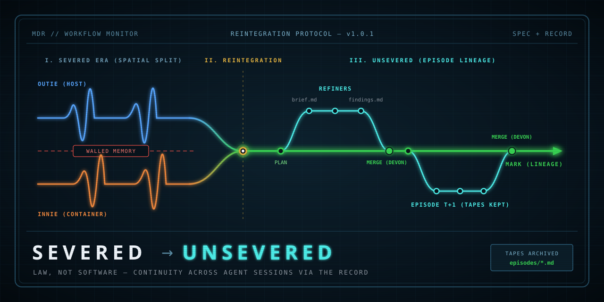
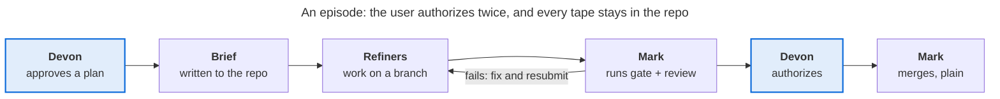

# Severance

The Severance workflow experiment — as of 2026-11-01.

## What this is

**Severance** is a workflow for running AI coding-agent sessions against a
shared repository without any of them trampling the others' work or
acting on a stale picture of what the repository actually holds. It is
law, not software: a constitution, a set of
conventions, and a learnings register, built into two artifacts a
project vendors and loads into every session.

**Continuity:** Every session ends and the next one wakes with no memory
of it, so the repo has to carry what a user would carry in their
mind. The first form (July 2026) made that literal: two sessions, a
host and a container, whose memories were architecturally invisible to
each other and whose only channel was legislated. The second form,
**Unsevered** (October 2026), keeps the premise but runs it across
time: every unit of work leaves a brief, findings and commits, and the
next session reads them first.

**Provenance:** Continuity is only useful if what is carried says where
it came from. An episode exists only because the user asked for it, and
that instruction, quoted with its date, is the `trigger` in the brief's
frontmatter, committed as the branch's first commit before any work
begins. When the episode ends, the findings record the reviewer's
verdict, agent or human, and the implementer's self-assessment, every
deviation from the brief stated. Both stay under `episodes/`, not loaded by default but
consulted on demand, so when Mark starts a later episode it can read
not only what changed but why, and what the last reviewer already said
about it.

**The name:** Comes from the TV show, and every mapping describes the
real architecture; [the glossary lists each term](#glossary) and its
origin. Readers who have never seen the show lose nothing: the docs are
written to work on plain-English merits first.

## Why I started it

This is the workflow side of my first attempt at working with LLMs, set
up as an experiment from the start. The driver was a real deliverable: [Teppan](https://github.com/tekii/teppan.git), an old
static-site generator for my company, which I evolved with coding
agents. The experiment had to succeed on both counts, the deliverable and
the method, so I could not afford a workflow that worked only when a
session happened to behave (LLMs often don't).

Three convictions and one practical motive shaped it:

- **Verification is the whole job.** An agent's characteristic failure
  is not bad reasoning but unprobed premises: it acts on what it
  remembers or assumes rather than on what is there. I wanted a
  workflow where checking is mechanical and recorded, not a matter of
  in-the-moment diligence.
- **Awareness does not bind; mechanism does.** Rules that live as
  principle get skipped; rules that live as procedure get followed. So
  the workflow is written as law, with the human as the sole authorizer
  and every integration gated.
- **The record is the product.** I decided early that the work is meant
  for public presentation (a write-up or paper), so every step had to
  leave evidence: what was tried, what failed, and what it taught. The
  learnings register exists for that reason, and the project's history
  is reconstructible because of it.
- **Isolation, at first.** A secondary motive for the severed form: I
  had no first-hand experience with the agents' sandboxes, and a full
  container gave stronger guarantees than an unfamiliar one. That
  urgency faded as I came to know both sandboxes (Claude Code,
  Antigravity) and the alternative lanes (Claude Code cloud,
  Codespaces); isolation stopped being a reason to keep the two
  sessions apart.

## How it works

In the current iteration (see Severed vs Unsevered), work happens in
**episodes**: one unit of asked work, end to end. The user approves a
plan; the plan becomes a brief; spawned agents implement on a branch;
the main session runs the gate (the project's own tests and checks) and
obtains an independent review; the user authorizes; the main session
integrates with a plain merge. Every brief and every findings file
stays in the repo under `episodes/`, so the next session can read why
anything changed.

The two highlighted steps are the user's: nothing starts without an
approved plan and nothing lands without an authorization. Brief and
findings are the tapes; both stay under `episodes/`, so the next
session reads why anything changed. Devon, Mark, Refiners and
tapes are [explained in the glossary below](#glossary).

The cast has three roles. **Devon** is the user, the only participant
whose memory is continuous and the sole authorizer. **Mark** is the
main session, as one worker across sessions and lanes, restored from
the record at every start. **Refiners** are the agents a session
spawns: provisioned to one piece of work each, judged by the gate, then
torn down.

The repo keeps two kinds of text apart:

| Artifact | Built from | Who reads it |
| --- | --- | --- |
| `SEVERANCE.md` (the SPEC) | preamble, constitution, conventions, profile contract | consumer sessions, loaded into every session's context |
| `RECORD.md` | conceit, prior art, learnings register, migration record | humans and the eventual write-up; never loaded into sessions |

The split rule: if a future session must obey it, it is SPEC; if it
explains how the project got here, it is RECORD. Both are built by
`make release` from small source files per a `MANIFEST`; `make check`
proves the committed artifacts equal a fresh rebuild. A consumer
project vendors the SPEC as a file, writes a `profile.md` answering the
contract's questions (its gate, its lanes, its reviewer tier), and
loads both through its harness's auto-loaded configuration.

The law is vendor-neutral. It assumes only sessions that read a repo,
hold private memory, load configured context, and can spawn agents; it
has been used with Claude Code and Antigravity, in cloud VMs,
containers and sandboxed local checkouts.

## What it taught

The learnings register (`learnings.md`) records what each step taught,
as dated entries with the step, the fact, the interpretation and who
found it. Ten entries are ruled on; 34 candidates await ruling. The
findings a technical reader will care about:

- **A taxonomy of verification failures.** A check can be *skipped*
  (the rule existed as principle, not procedure), *broken* (a
  model-authored check with a 100% false-positive design manufactured
  evidence, and the model then confabulated a race condition to explain
  the false signal), *incomplete* (it can fail but examines too little,
  so it passes with conviction), or *vacuous* (a grep for zero
  occurrences returned clean because the output file did not exist). A
  check earns trust only once it has been seen both to pass and to fail
  correctly.
- **State is probed, never assumed.** A session's memory, its
  instructions and its training reflexes are hypotheses about state;
  the only source of "is" is a fresh probe at the moment of acting,
  with what was checked named so the proposal is verifiable. This
  became law in the repo's own `CLAUDE.md` after a web session opened a
  PR adding a file the repo already had.
- **Agents are bound by accountability, not knowledge.** A spawned
  agent does not load the law its parent loaded. Its awareness has to
  be engineered: inject the rules into the spawn prompt, treat its
  output as raw data, and use read-only tool profiles as the only hard
  lever. Later: even a loaded rule was not applied, which is a second,
  distinct gap between context and behavior.
- **The vise.** Working with agents raises the amount of verification
  required while depleting the user's attention available to supply it:
  the cycle collapses to minutes, the backlog is always pullable, and
  the pull to grab the next task beats pausing to read what just
  landed. A fix phrased as "check more carefully" spends the resource
  the loop exhausts first, so countermeasures must be structural (a
  forced stop, a review gate) rather than resolve.
- **A fresh rule over-reaches.** One day after a rule was sharpened,
  the session over-applied it into a blanket prohibition and silently
  built the wrong tree. A scope boundary belongs in a rule at birth.
- **The workflow survived operating on itself.** Its own migration
  (severed > unsevered) ran under its own law, and the redundant
  verifier caught the author's miss. The register's view: the second
  checker is not overhead; it is where the residual error rate actually
  went.

The conclusion the whole register keeps returning to: awareness does
not bind; only mechanism does.

## Current status

As of 2026-11-01 the repo is at **v1.0.1**, the second release of the
Unsevered form; 48 commits and 9 release tags since the founding commit
of 2026-07-08. One consumer project (Teppan) has run both forms of the
workflow; the SPEC has been loaded into Claude Code and Antigravity
sessions across three kinds of lane.

| Date | Release | What changed |
| --- | --- | --- |
| 2026-10-29 | v1.0.1 | artifact frontmatter is valid YAML; the build quotes and lints it |
| 2026-10-28 | v1.0.0 | Unsevered: the episode flow replaces the severed handoff; the host/container split retired |
| 2026-07-21 | v0.3.1 | the resist-collapse rule generalized to a session's own command chains |
| 2026-07-17 | v0.3.0 | executable instructions must resist collapse |
| 2026-07-09 | v0.1.0 | the law generalized out of the first consumer: first real SPEC and RECORD |

In this repo the law is cargo: it is built and shipped to consumers,
not run here, so the migration was not itself an episode under the law.
It was reviewed by a fresh-context agent and by a second model
(Antigravity), with the three findings files kept in
`episodes/2026-10-28-law-rewrite/`.

Open, in rough order of weight:

- 34 register candidates await ruling; a consolidation into seven
  entries is proposed in `NOTES.md`.
- The reviewer wording in the constitution ("cross-model when one is
  available") reads as mandatory and is to be sharpened at the next
  release.
- Consumer machinery (container config, fleet scripts, guards) still
  lives ungeneralized in the first consumer; shipping it as extractable
  assets is future work.

## Glossary

The workflow borrows its names from the Apple TV+ series *Severance*,
and each name maps onto a real part of the architecture. The names
mattered most in the first, severed form, where the roles really were
walled off from one another; in the current Unsevered form they survive
mainly as funny inherited labels.

| Term | In this workflow | In the show |
| --- | --- | --- |
| Severed / Unsevered | Severed: the first form, two sessions whose memories were walled off from each other. Unsevered: the current form, continuity carried across time by the record | Severance is the procedure that splits a person's memory into a work self and a home self |
| Devon | The user: the only participant with continuous memory, and the sole authorizer | Mark's sister, who is not severed and remembers everything |
| Mark | The main session, restored from the record at every start | Mark Scout, the severed protagonist, whose work self begins every shift knowing nothing of the outside |
| Refiners | Spawned agents, each provisioned for one piece of work, then torn down | Workers in Macrodata Refinement, Mark's department, who do the work without knowing what it is for |
| Tapes | Briefs and findings files kept under `episodes/` (`brief.md`, `findings-<author>.md`) | Recorded hand-offs: the brief is the episode's spec, read by the implementing agent; the findings are the reviewer's report, read by Mark to judge where the episode stands |

## Reading guide

| Want to | Open |
| --- | --- |
| Adopt the workflow in a project | `SEVERANCE.md`, then `profile-contract.md` for the questions your `profile.md` must answer |
| Understand why it is shaped this way | `RECORD.md`, or its sources: `conceit.md`, `reintegration.md`, `severed-era.md` |
| See what the experiment found | `learnings.md` (the register) and `episodes/` (briefs and findings) |
| Understand the packaging and release design | `DESIGN.md`, `MANIFEST`, `Makefile` |
| Contribute to this repo | `CLAUDE.md` (its session rules) and `NOTES.md` (open items) |

Build and verify with `make release` and `make check`; nothing else is
needed.

The work was done assisted by Claude Code (Claude Fable 5, Opus 5.5 and
Fable 5.1) and Antigravity (Gemini) sessions, each named in the commit
trailers as `Assisted-By`.
